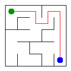

# Assignment 3. Maze Escape

Student ID:
Name: Alimurat Nurbakyt
Group: SE-2512
Maze size (rows x columns): 10 x 12

This file is the report. Fill it in as you go. How to start: `START_HERE.md`. The task: `docs/Assignment3.pdf`.

## Program output

The 13 lines your program prints on your data (`java -cp out Main`):

    Broken: 71
    Kept: 56
    Last broken wall: 93
    MST cost: 18026
    Heaviest broken wall: 678
    Path length: 27
    DFS visited: 56 
    Dead ends: 22
    Zones: 72
    Largest zone: 1
    Is DAG: 1
    Flow stages: 11
    Fastest route cost: 10

My maze:

## Questions

Answer in your own words, two or three sentences each.

Mission 0: DSU with union by size and path compression
Mission 1: build maze, break walls in file order
Mission 2: Kruskal and Prim MST
Mission 3: iterative DFS escape
Mission 4: Kosaraju zones
Mission 5: DAG pass for fastest route
## AI use

Claude: explained algorithms, helped write and review code.
## Timing (Mission 7)

Milliseconds, 5 runs each, from `java -cp out Bench`.

| maze | Kruskal | Prim |
|---|---:|---:|
| 100 × 100 | 23 ms | 11 ms |
| 300 × 300 | 120 ms | 80 ms |
| 1000 × 1000 | 1717 ms | 1806 ms |

What do the numbers say about how the time grows? Two or three sentences.

## Complexity

n is the number of cells, m the number of walls (or slides). Fill in every algorithm you wrote.

| algorithm | time | space | assumptions |
|---|---|---|---|
| DSU find and union | Amortized `O(α(n))` per operation | `O(n)` | Union by size and path compression |
| Kruskal | `O(m log m)` | `O(n + m)` | Sort walls by cost; use DSU |
| Prim | `O((n + m) log m)` | `O(n + m)` | Priority queue and adjacency lists |
| DFS | `O(n + m)` | `O(n + m)` | Iterative DFS on the maze graph |
| Kosaraju | `O(n + m)` | `O(n + m)` | Forward and reverse slide graphs |
| Route in the zone graph | `O(z² + m)` | `O(z²)` | `z` is the number of zones; uses a zone cost matrix |

## Before you submit

- data/walls.txt, data/slides.txt and output/maze.png are in the repository.
- `java tools/Check.java` shows all examples right.
- This README is filled in, the program output and the section AI use included.
- The work is pushed to main (at least one commit per mission) and the repository is public.
- The link is attached in Moodle.
